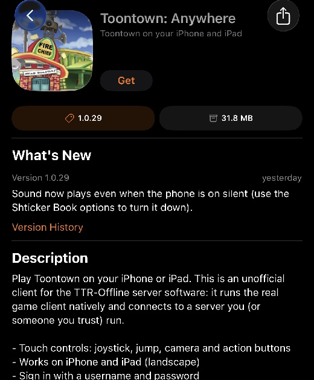

# Toontown: Anywhere

An **unofficial** iPhone and iPad client for **TTR-Offline** servers. It is not affiliated with, endorsed by, or
connected to Toontown Rewritten, its team, or Disney, and it **cannot connect to the official Toontown Rewritten
servers**.

## Credits

This project exists because of other people's work. Thank you to:

- **[RegDogg](https://github.com/RegDogg)** for **[TTR-Offline](https://github.com/RegDogg/TTR-Offline)**
  (Apache License 2.0). The game client this app runs, and the server it talks to, are TTR-Offline. Every bit of
  the game itself is his work and the work of the people TTR-Offline builds on. This app is only a way to run his
  client on iOS. He also maintains the
  [TTR-Offline Panda3D fork](https://github.com/RegDogg/TTR-Offline-panda3d) that the app is built on.
- The **[Panda3D](https://www.panda3d.org)** team and contributors, for the engine.
- The **[BeeWare](https://beeware.org)** project, for
  [Python-Apple-support](https://github.com/beeware/Python-Apple-support), which makes embedding Python on iOS possible.
- The **[SideStore](https://sidestore.io)** project, for making on-device sideloading practical.
- The authors of OpenSSL, libpng, libjpeg, FreeType, and libogg/libvorbis. The full list with licenses is in
  [THIRD_PARTY_NOTICES.md](panda_ios/THIRD_PARTY_NOTICES.md), which is also bundled inside the app.

**This repository contains no game files.** No game code, models, textures, or audio. The app downloads the client
code and resources at first launch from the **file server it was built for**, and connects to the **game server it
was built for**. This project's own code is only the iOS app shell, the touch controls and the build scripts.

## Screenshots

Screenshots of the game are in the app's listing in SideStore. This is how the listing looks:



## Install with SideStore

The easiest way to install the app is through a **SideStore source**, which also delivers updates.

1. Set up SideStore on your device by following the official guide: **<https://docs.sidestore.io>**
   (project: <https://github.com/SideStore/SideStore>).
2. In SideStore, open the **Sources** tab and tap **+**.
3. Paste this source address:

   ```
   https://toontown.puffsco.com/_app/anywhere/source.json
   ```

4. Open **Toontown: Anywhere** in the source and tap **Get**. New versions then show up as updates in SideStore.

Notes:
- The source lists the newest build only. Each entry includes the file size and a SHA-256 checksum.
- The app is **not** from the App Store. Sideloaded apps expire and need refreshing (SideStore does that for you
  while it is running, as long as it is set up).
- If the source's name or icon looks out of date, remove the source and add it again.
- Other sideloading tools like [AltStore](https://altstore.io) work too, using the `.ipa` from your own build.

The app provided in the SideStore source and this repo connects to my own server. To
run your own server, build your own app instead (next section).

## Choosing a server

The first time you open the app it asks which server to play on:

- **Connect to Toontown: Anywhere** uses the server the app was built for (the default).
- **A different server:** type in the server's file address (for example `https://files.example.com`) and its game
  address (`host:port`, for example `play.example.com:7298`), then tap **Connect**. The app checks that both are
  reachable before saving them.

The app remembers your choice. The **Change server** button on the sign-in screen switches to another server later.
Each server keeps its own downloaded game files, saved username and password, so switching back is quick. Game
files are only downloaded after you have picked a server.

**Only connect to servers you trust.** A server supplies the game's code, and that code runs inside this app.

## Build your own app for your own server

The server addresses are baked in at build time as the app's **default server**. (Players can also type in a
different server inside the app, see "Choosing a server" above, so building your own is only needed if you want
your own server to be the default.)

1. **Fork this repository** on GitHub and enable Actions on the fork.
2. Run the **panda-ios** workflow (Actions, Run workflow). Inputs:
   - `resource_server`: URL of your file server, for example `https://files.example.com` or `http://192.168.1.10:7380`
   - `game_server`: `host:port` of your game server, for example `play.example.com:7298`
3. Download the **TTRPanda-ipa** artifact. It is an **unsigned** `.ipa`.
4. Sign and install it yourself (SideStore, AltStore or Feather).

After the first full run, **panda-ios-app** rebuilds just the app shell from that run's saved libraries (about a minute).
It takes the saved run's id as an input.

### Publishing your own SideStore source

A source is one JSON file (`source.json`) that lists your app and where to download the `.ipa`. Host it and the
`.ipa` on any static web server. SideStore documents the format. Mine lists each version with its date, download
URL, size and SHA-256, plus an icon address.

## What your servers need to provide

**Game server:** a running [TTR-Offline](https://github.com/RegDogg/TTR-Offline) server (Astron, UberDOG and an AI).
The app connects with a play cookie of the form `name:password`. A plain TTR-Offline server accepts any cookie. If
you want real passwords, your account service has to check them.

**File server** (static HTTP or HTTPS), whose root contains:
- the TTR-Offline `resources` folders (`phase_3` and so on), and a `_code/` folder with the game's Python code
  (`toontown/`, `otp/`, `config/`)
- `manifest.json`, made with `python3 panda_ios/make_manifest.py /path/to/served/folder`
- optional, but much faster first installs: `packs.json` and `_packs/*.zip`, made with
  `python3 panda_ios/make_packs.py /path/to/served/folder` (run it after the manifest)
- optional: `_ui/background.jpg` and `_ui/logo.png` for the start screen
- optional sign-in and password-recovery endpoints (the app calls them if present; a `404` means the server
  doesn't have them and the app carries on):
  - `POST /auth`: body `name:password`. Answer `200` for ok, or `403` with a message to show the player. Answering
    `200` with the body `setup` asks the app to offer the player a password-recovery setup.
  - `POST /setrecovery`: body is three lines: `name:password`, a nickname, and a toon name.
  - `POST /recover`: body is four lines: name, nickname, toon name, new password. Answer `200` when the answers match
    and the password was changed.

You are responsible for having the right to host whatever you serve. Check the licenses of the TTR-Offline code and
the resources repository before you share anything.

## What the build does
1. Clones the Panda3D fork used by TTR-Offline and applies small patches (`panda_ios/patch_sources.py`).
2. Builds OpenSSL, libpng, libjpeg, FreeType, Ogg/Vorbis for iOS, and Panda3D with an OpenGL ES 1 display.
3. Embeds Python (BeeWare Python-Apple-support) and produces the unsigned `.ipa`.

## Features
- Native iOS: Panda3D 1.10 (the TTR-Offline fork) and CPython 3.10 cross-compiled for iPhone and iPad.
- Touch controls (joystick, jump, camera, action) that hide whenever a menu or panel is open.
- A keyboard bridge for typed chat, iPad scaling, and sound that plays even when the phone is on silent.
- Sign-in with a username and password, with optional password recovery (see above).

## Status
Experimental. Developed and tested on iPhone and iPad with dev-signed builds. The OpenGL ES 1 API it uses is
deprecated by Apple.

## License and notices
Apache License 2.0, see [LICENSE](LICENSE). Third-party components and credits are listed in
[THIRD_PARTY_NOTICES.md](panda_ios/THIRD_PARTY_NOTICES.md), which is also bundled inside the app.

Toontown is a trademark of Disney. This is a fan project with no commercial purpose.
